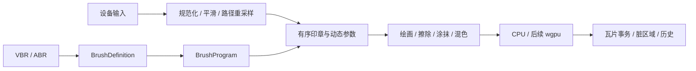

# 统一笔刷系统设计

状态：2026-10-14，分阶段实施。程序/图片笔尖、原生目录、VBR1.1、描边与ABR6/10基础导入已有阶段实现，见 [路线与结果](roadmap.md)、[ABR入口验收](abr-entry-validation.md)。完整ABR动态、VBR来源交换与动态湿混仍待完成，本文不代表整体实现验收。

目标：达到 Procreate 类笔刷的参数深度与线条手感，逐步兼容 Photoshop ABR，采用开放的 VBR 原生格式。画笔、橡皮和独立涂抹工具复用同一系统，保留 Rust → C ABI → PaintCoreClient → QML 边界。Python 插件最后实施。

验收计划：[brush-system-validation.md](brush-system-validation.md)。原生格式：[vbr-format-design.md](vbr-format-design.md)。当前真实实现仍以 [brush-library-design.md](brush-library-design.md)、[smudge-design.md](smudge-design.md) 和代码为准。

## 1. 当前基础与改造边界

现有 `paint-core::Brush` 支持圆笔、半径、不透明度、间距和绘画/擦除/涂抹模式。`InputPoint` 已提供位置、压力、倾斜、旋转、切向压力、设备能力和时间戳；尚未全部参与笔刷动态计算。文档已有稀疏瓦片、COW、分页、选区覆盖、锁、蒙版、单笔事务历史与后台预览。

`BrushLibrary` 当前在 Qt 侧保存有限参数和预设，不能直接扩成另一个执行引擎。迁移后它仍作为共享 UI 模型，Rust 负责笔刷定义验证、资源与运行语义；PaintCoreClient 通过 ABI 获取元数据和提交修改。现有预设、选中状态、工具独立大小与涂抹参数需要迁移，不能静默重置。

普通旧圆笔使用兼容行为版本，保留原有像素结果。新参数引入新的行为版本，不把引擎升级自动应用到旧预设。当前大小等上限不通过只改 QML 绕过，扩展时同时检查内核、ABI、资源预算、持久化与 UI。

## 2. 统一执行模型

- **BrushDefinition**：不可变、可序列化的笔刷定义，包含资源引用、参数、曲线、模块开关和行为版本。
- **BrushProgram**：经验证和编译的执行计划；预计算曲线表、纹理变换及专用执行路径，缓存按定义版本和资源哈希索引。
- **StrokeState**：单笔运行状态，包含输入滤波、路径距离、上一印章、固定随机种子、载色与有限笔尾。不得写回预设或跨文档共用。
- **DabCommand**：后端无关的有序印章描述，包含文档坐标、变换、覆盖/颜色参数、取样规则与序号；CPU/GPU 共用语义和生成逻辑。

首期在 paint-core 内按职责拆分模块；只有形成实际需要时才建立独立 crate，不提前创建空壳。文件解析在 paint-io，任务调度在 paint-task，paint-ffi 组装资源和文档操作。GPU 设备与管线由执行后端负责，不引入 Qt 依赖，也不让 paint-render 的视口合成器直接修改权威文档。

画笔、橡皮和涂抹共享笔尖、纹理、动态和路径生成。写入算子明确不同：画笔沉积颜色，橡皮减少覆盖，涂抹搬运/混合颜色。涂抹仍为独立 R 工具，保留强度、压感、所有图层取样、手指绘画。预设选择不切换工具。

## 3. 输入与线条手感

输入统一文档像素、单调时间和归一化设备通道。缺失压力时采用默认值，缺失倾斜/旋转时使用预设方向；不得将“设备没有这个能力”解释为用户正在施加零压力。旋转插值走最短角度路径，避免跨 ±180° 的跳变。

位置平滑、压力平滑分别设置。轻量速度自适应滤波和可选稳定器先实现；保留关闭平滑的直接输入路径。滤波按时间而非事件个数计算，低速不抖、快速不过度拖尾。预测若引入，只用于可撤销的临时呈现，不把尚未发生的点写入正式历史。

沿累计弧长放置印章，跨输入段保留间距余量。VBR 间距使用直径比例，最低 0.01（界面 1%）；明确基准直径或动态直径模式，首期以基准直径兼容现有实现。喷枪按时间触发是独立可选模式，不能将设备事件频率当成流量。

尺寸、不透明度、流量等控制分别拥有曲线及最低值。控制来源包括压力、倾斜、旋转、方向、速度、笔触距离与随机值。组合顺序固定：基础值 → 控制曲线 → 随机调制 → 合法范围裁剪；每个目标声明单位和允许的来源。

起笔/收笔支持长度、尺寸和透明度曲线；鼠标可使用模拟收尖。依赖抬笔信息的收尖只回算有界笔尾，恢复该区域原始快照后重绘，不能结束时重放整条笔触。正式结束后预览必须与提交结果一致。

“Procreate 级手感”作为实测目标，不作为复制专有算法或已经达到的声明。以慢速圆弧、快速折线、轻压起笔、快速抬笔、倾斜侧锋及不同输入频率评估。

## 4. 笔尖、纹理与动态

| 模块 | 运行行为 |
|---|---|
| 笔尖形状 | 程序圆/椭圆、灰度图片覆盖；大小、硬度、圆度、角度、间距 |
| 形状动态 | 尺寸/角度/圆度随控制来源变化；角度可跟随路径方向 |
| 散布 | 沿路径和垂直路径散布、印章数量与数量变化；固定随机序列 |
| 纹理 | 笔尖局部移动纹理、文档固定纸纹；缩放、旋转、深度和覆盖组合 |
| 双重笔刷 | 第二个笔尖参与覆盖计算，声明组合方式和自己的动态 |
| 颜色动态 | 前景/背景混合及色相、饱和度、明度变化，明确每笔/每印章频率 |
| 传递 | 流量与不透明度分别控制，不复用一个参数冒充两种行为 |

执行顺序：路径/动态 → 笔尖覆盖 → 双笔尖组合 → 纹理 → 流量/颜色或搬运 → 选区与写入锁限制 → 瓦片混合。图层蒙版和剪贴仍沿用文档合成规则，不能被笔刷重复应用。纹理固定于文档坐标，不随视口缩放/平移漂移。

## 5. 覆盖、混色与载色

区分单印章流量、整笔不透明度和图层不透明度。提供明确的积累模式及整笔覆盖上限模式；后者维护有界、可分页的笔触覆盖状态，防止密集重叠突破整笔设定。不使用改变印章间距来近似修正颜色积累。

混色笔刷增加载色量、拾色强度、携带/拾取混合比例、沉积流量、沿距离消耗、每笔自动清洗/重新载色。简单均匀载色与二维载色缓冲是不同能力，二维缓冲允许不同笔尖位置携带不同颜色。透明底色的拾取、透明锁、选区边缘和蒙版目标均需明确行为。

每个印章读取写入前状态，再提交该印章结果；下一印章可读取上一个印章的已提交结果。所有图层取样来自该时刻的可见合成，只写当前目标层。取样范围和写入选区分别控制，不能把选区外取样隐式当成透明。

颜色混合模型显式版本化：现有线性预乘 RGBA 保持为默认工作基础，ABR 近似映射可能需要指定另一种颜色计算规则。透明颜色不能以直接平均 RGB 处理；“颜料混合”不能仅改名包装普通 RGB 插值。首期完成二维厚涂/湿混外观；具有实际厚度和光照的颜料堆积需未来高度/材质模型，不属于首期。

## 6. ABR 兼容层

ABR 解析和转换为 BrushDefinition，执行期不维护独立 Photoshop 引擎。以实际文件版本和测试样本建立支持矩阵，不预先承诺所有 ABR 或逐像素等同 Photoshop。

| 层级 | 导入目标 |
|---|---|
| 基础 | 笔尖、名称、尺寸和间距 |
| 常用动态 | 形状动态、散布、传递、纹理、双重笔刷 |
| 特殊行为 | 经样本验证后支持、近似映射或明确拒绝 |

导入报告列出完整支持、近似转换、暂不支持的具体设置及原因。未知字段可作为不参与执行的来源信息保留；保留字段不等于支持其行为。批量导入先完成解析与资源验证，再原子提交，不留下半成品预设。ABR 导入与混合器画笔实现是不同工作项。

首期提供 ABR 导入及 VBR 导出，不承诺 ABR 导出。后续若导出，必须先报告目标格式无法表达的设置。资源分组、同名预设和重复笔尖以稳定 ID 和内容哈希处理。

## 7. VBR 与预设生命周期

VBR 为 ZIP 容器，JSON 保存预设与曲线，PNG 保存笔尖与纹理，预览只是缓存。具体契约见 [vbr-format-design.md](vbr-format-design.md)。格式版本与行为版本独立，公开 Schema、合法/非法样本及迁移规则。

Rust 拥有经验证的定义和不可变资源。QML 编辑草稿通过 PaintCoreClient 原子提交一个修订；绘画开始捕获当前定义和工具参数快照，笔触中修改设置只影响下一笔。活动预设、库持久化与文档历史分别管理：编辑预设不生成画布历史，取消/撤销画布笔触不回退预设修改。

内置预设可在活动编辑状态调整，保存为用户副本时分配新 ID。保留重置和显式保存行为，不能修改资源包里的内置文件。迁移失败保留旧数据并报告原因，不通过覆盖默认库伪装成功。

## 8. PS 风格笔刷设置界面

保持“笔刷库负责选择、笔刷设置负责编辑”的分工。设置页左侧分类、右侧详细参数、底部固定真实预览，所有停靠/浮窗实例读取同一活动预设，不复制编辑状态。

左侧分类顺序：笔尖形状、形状动态、散布、纹理、双重笔刷、颜色动态、传递、笔触与平滑、湿混与载色、光标与预览。基础笔尖不可关闭；可选功能名称点击只选分类，独立复选框控制启用。关闭功能后仍可查看/编辑其参数，暂不参与绘画。

右侧采用现有紧凑数值框、滑条、组合框和通用复选框。曲线编辑提供恢复默认、端点和数值输入；所有控件只对应真正实现的能力。未实现分类在产品界面暂不展示，不放置假成功开关。ABR 转换信息在预设信息中可查看。

常用大小等继续在工具详情栏快捷调整。颜色及工具独立参数不混入预设基础定义。左列宽度稳定、右侧独立滚动、底部预览保持可见；窄面板允许收起分类列表进入选择控件，不裁掉参数。记住分类和滚动位置，并沿用既有停靠、浮窗、图标展开的焦点机制。

参数提示统一鼠标悬停 1000ms；工具快捷键不得抢占数值/搜索/名称编辑输入。预览试画区有明确的独立输入焦点，退出后恢复相应窗口的操作焦点。

预览使用隔离的真实 Rust session，固定输入轨迹和随机种子；提供线条/压力渐变示例及可试画区域。湿混预览使用明确的有色底样，避免透明底上的结果无法体现拾色。快速设置修改做后台 debounce/token 过期丢弃，不能影响主文档的 revision、dirty 或历史。

## 9. 笔刷光标描边与悬停预览

这里的“描边”指跟随指针的笔尖覆盖轮廓，不给画到图层上的笔触添加外描边。基于用户已确认的光标预览讨论，不另加绘画效果模块。

画笔、橡皮、涂抹共用轮廓系统：圆笔显示圆形，扁平刷显示旋转椭圆，图片笔尖显示基础覆盖边界。随大小、视口缩放和已知倾斜/旋转更新；悬停压力未知时使用标称尺寸，落笔后可使用当前压力计算的尺寸。设备无倾斜/旋转时使用预设值。

| 全局偏好 | 默认/行为 |
|---|---|
| 描边预览 | 开启；可选择实际基础笔尖轮廓或简化圆形 |
| 描边样式 | 黑白双线；支持自定义颜色与线宽 |
| 中心十字 | 默认关闭，可独立开启 |
| 半透明笔尖图片 | 默认关闭，透明度可调 |
| 显示时机 | 默认悬停和绘画均显示，可设仅悬停 |

这些属于全局显示偏好，不写入 VBR。散布/随机笔刷显示基础笔尖和作用范围，不以随机变化的完整下一笔效果让光标抖动。纸纹不会改变基础轮廓；双重笔刷的轮廓能力必须标明是组合覆盖或基础笔尖预览。

轮廓按资源哈希、覆盖阈值和必要的组合参数缓存。初始覆盖阈值 0.5，保留孔洞和多个连通区域；屏幕误差有界简化。位置/缩放/旋转以变换更新，不随每次移动重新扫描位图。线宽以设备无关屏幕单位保存，处理 DPR 后保持可见，不随文档缩放变粗。缓存有资源上限和失效规则，不能无界保留笔尖资源。

光标完全在显示层绘制，不进入图层、导出、历史或缩略图。移出画布/失活隐藏；空间平移、Alt 吸色、Ctrl 临时移动、液化和自由变换按当前操作优先级接管光标。沿用 Caps Lock 精确光标规则。首次生成未就绪时临时显示简化轮廓，不阻塞输入。

## 10. 性能、CPU/GPU 与事务

优先复用现有瓦片、选区行覆盖、COW 与分页；缓存曲线、笔尖 mip、纹理和轮廓。无动态圆笔保留专用快路径，纹理/湿混不增加普通圆笔的逐像素分支。1% 间距需要真实密集印章验收，不能静默提高间距或丢弃压力峰值来通过性能测试。

重工作按有序任务分块，End/Cancel 不可越过尚未完成的印章。呈现通知可合并，绘画语义不能随意合并；如果压缩输入，必须证明路径、压力和时间相关效果保持。资源/磁盘失败撤销整笔实际修改，不返回假成功。

CPU 为参考实现。后续 wgpu 共用 BrushProgram、DabCommand 和资源语义，像素循环与 shader 分别实现。湿混严格保持印章顺序，印章内部可并行，不能把所有印章无序分发。GPU 输出通过文档事务进入权威瓦片；渲染缓存不是另一份未提交文档。

同后端重放要求稳定；CPU/GPU 对比采用明确的像素容差和视觉边界，不能保证所有硬件浮点逐位一致。撤销保存真实 before/after 瓦片变化，不依赖更换后端后重放随机笔触恢复像素。

ABI 不扩写现有 DTO 布局。使用版本化的新导出、尺寸检查及不透明资源/定义句柄；调用方内存在返回前复制，定义快照由引用计数保持到任务结束。具体函数和新增 minor 在实施模块设计中确定；当前已实施至 ABI 1.28，详见正式 ABI 契约，不提前添加未实现导出。

## 11. 实施顺序

1. **定义与迁移**：统一定义、不可变资源、行为版本、VBR 最小读写、旧圆笔兼容；设置布局先承载已有真实参数。
2. **线条与笔尖**：输入/压力曲线、流量与整笔透明度、图片笔尖、基础描边和真实预览；先形成可靠的线稿笔。
3. **纹理与兼容**：纹理、散布、双重笔刷、颜色动态；ABR 先基础再常用动态，不等待全部模块才开始导入。
4. **湿混与涂抹**：载色、拾色、消耗、二维载色和涂抹升级；建立厚涂与混色预设。
5. **GPU 与扩展兼容**：基础语义稳定并有实测瓶颈后接入 wgpu；不要求所有笔刷能力实现完才开始加速。

每阶段先细化设计/验收，再实现并按实际能力发布，验证后独立提交。首批验收预设为压感线稿笔、倾斜铅笔、纹理干刷、扁平刷、混色笔。详见验收计划，不能以只显示参数或只解析文件代替功能完成。

## 12. 外部行为参考

- [Procreate Brush Studio Settings](https://help.procreate.com/procreate/handbook/brushes/brush-studio-settings)：路径、稳定、收尖、形状、纹理、渲染和湿混等公开行为参考。
- [Adobe Mixer Brush](https://helpx.adobe.com/photoshop/desktop/apply-painting-techniques/create-fill-with-patterns/paint-with-mixer-brush.html)：载色、拾色、混合与流量的产品行为参考。
- [Adobe ABR 导入](https://helpx.adobe.com/photoshop/desktop/apply-painting-techniques/brushes-presets/import-brushes-brush-packs.html)：格式使用参考；此产品帮助页面不作为完整二进制解析规范。
